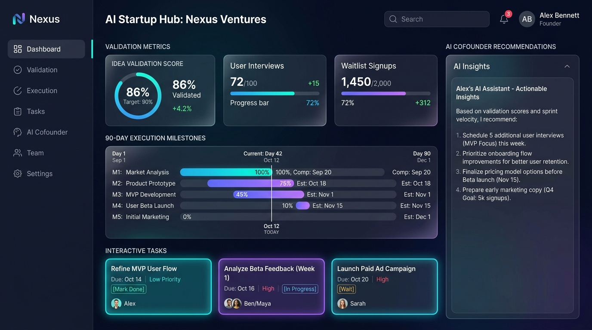

<div align="center">

  

  # AI Co-Founder
  ### *From Raw Startup Hypothesis to Flawless 90-Day Execution*

  <p align="center">
    <b>Empowering solo founders and early-stage builders with an autonomous executive suite: strategic roadmapping, customer validation, ruthless scope reduction, and distribution playbooks.</b>
  </p>

  <p align="center">
    <a href="https://nextjs.org/"></a>
    <a href="https://react.dev/"></a>
    <a href="https://www.typescriptlang.org/"></a>
    <a href="https://tailwindcss.com/"></a>
    <a href="https://ai.google.dev/"></a>
    
  </p>

  <br />

  

</div>

---

## 💡 The Problem & The Vision

> **90% of early-stage startups fail not from poor code, but from building things nobody wants, falling into scope creep, and losing sprint discipline.**

Solo founders often juggle four executive roles simultaneously: *Chief Executive*, *Head of Customer Discovery*, *Technical Lead*, and *Growth Marketer*. Context switching causes paralysis.

**AI Co-Founder** solves this by providing a complete, synchronized AI executive suite that doesn't just chat—it **plans, prioritizes, challenges assumptions, drafts deliverables, and keeps you accountable.**

---

## ✨ Key Features & Capabilities

```
                  ┌─────────────────────────────────────────────────────────┐
                  │                 Founder Vision & Intake                 │
                  └────────────────────────────┬────────────────────────────┘
                                               │
                                               ▼
                         ┌───────────────────────────────────────────┐
                         │   Dynamic 90-Day Execution Engine         │
                         │   (M1: Validate ➔ M2: MVP ➔ M3: Launch)   │
                         └─────────────────────┬─────────────────────┘
                                               │
               ┌───────────────────────┬───────┴────────┬──────────────────────┐
               ▼                       ▼                ▼                      ▼
     ⚡ Alex Vanguard            🔍 Scout          🚀 Pulse               🛠️ Nexus
     (Chief of Staff)          (Discovery)       (Growth & Sales)       (Tech Architect)
     • Daily Sprint Triage     • Mom Test Scripts• Cold Outreach        • Scope Cutter
     • Readiness Calibration   • Competitor Intel• Waitlist Playbooks   • Single-Loop MVP
               │                       │                │                      │
               └───────────────────────┴───────┬────────┴──────────────────────┘
                                               │
                                               ▼
                      ┌─────────────────────────────────────────────────┐
                      │    Living Artifacts Vault & Knowledge Base      │
                      │    (PRDs, Discovery Guides, ICPs, Pitch Decks)  │
                      └─────────────────────────────────────────────────┘
```

### 🧠 1. Intelligent 4-Step Onboarding Engine
- **Intake Flow**: Captures target market, problem statement, solution wedge, and immediate runway.
- **Instant Roadmap Synthesis**: Generates customized 30-60-90 day milestone phases with tangible deliverables and weekly priorities.

### 👥 2. Specialized Multi-Agent Executive Squad
Interact with focused AI co-founders, each programmed with distinct domain heuristics, communication styles, and operational routines:

| Agent Persona | Role | Core Responsibility | Signature Routine |
| :--- | :--- | :--- | :--- |
| **⚡ Alex Vanguard** | Chief of Staff & Strategy | Sprint discipline, blocker triage, and readiness score audits | Morning Milestone Triage & Blocker Sweep |
| **🔍 Scout** | Head of Customer Discovery | Behavioral user interviews (*The Mom Test*), pricing validation | Unbiased Customer Interview Scripting |
| **🚀 Pulse** | Head of Growth & Outbound | High-converting cold outreach, waitlists, and channel launch | Cold Discovery Outreach & Launch Teardowns |
| **🛠️ Nexus** | Principal Product Architect | Eliminating non-core features, rapid MVP architecture (<14d build) | Ruthless Scope Reduction Audit |

### 🗺️ 3. Dynamic 90-Day Milestone Planner
- Clear phase progression: **Month 1 (Customer Validation)**, **Month 2 (Minimum Viable Prototype)**, **Month 3 (Pilot Onboarding & Launch)**.
- Filterable execution tasks with priority weights, AI implementation tips, and real-time completion tracking.

### 📑 4. Living Artifacts Vault
- Auto-generates structured documents in Markdown, checklist, and schema formats.
- Pre-loaded with essential startup deliverables: **Mom Test Interview Guides**, **MVP Scope Specifications**, **B2B Cold Outreach Blueprints**, and **Competitive Tear-downs**.

### 📚 5. Central Knowledge Base
- Persists your startup's core context, buyer personas, market research, and strategic pivots in a centralized repository accessible by every agent.

---

## 💻 Tech Stack & Architecture

- **Core Framework**: [Next.js 15](https://nextjs.org/) (App Router & Server Actions)
- **UI Library**: [React 19](https://react.dev/)
- **Programming Language**: [TypeScript](https://www.typescriptlang.org/) (Strict typing throughout)
- **Styling & Theme**: [Tailwind CSS v3](https://tailwindcss.com/) with a bespoke dark navy glassmorphic design system
- **Icons**: [Lucide React](https://lucide.dev/)
- **AI Backend**: Direct REST integration with [Google Gemini 1.5 Flash](https://ai.google.dev/) + heuristic fallback personas
- **State Management**: Centralized React Context (`StartupContext`) with persistent client state

---

## 📂 Project Structure

```text
AI_CoFounder/
├── public/
│   └── images/
│       ├── logo.svg                 # Brand vector glyph
│       ├── hero-dashboard.webp      # Hi-res dashboard preview
│       └── reflection-bg.webp       # Subtle ambient floor glow
├── src/
│   ├── app/
│   │   ├── layout.tsx               # Root layout & dark theme provider
│   │   ├── page.tsx                 # High-converting landing & value proposition
│   │   ├── globals.css              # Custom glassmorphic utilities & animations
│   │   ├── dashboard/page.tsx       # Founder mission control & readiness scores
│   │   ├── onboarding/page.tsx      # 4-stage interactive startup intake
│   │   ├── planner/page.tsx         # 90-day milestone roadmap view
│   │   ├── agents/page.tsx          # Multi-agent roster & routine execution
│   │   ├── chat/page.tsx            # Multi-agent strategic advisory war room
│   │   ├── artifacts/page.tsx       # Generated startup PRDs & deliverables
│   │   ├── knowledge/page.tsx       # Founder knowledge base & market insights
│   │   └── api/
│   │       ├── chat/route.ts        # Gemini inference & agent persona router
│   │       └── health/route.ts      # Platform diagnostic telemetry
│   ├── components/
│   │   ├── agents/                  # Routine cards, agent detail modals
│   │   ├── chat/                    # ChatWindow, ChatMessage, quick prompt pills
│   │   ├── dashboard/               # ProgressCard, MilestoneList, TaskList
│   │   ├── landing/                 # HeroSection, FeatureSection, HowItWorks
│   │   ├── layout/                  # Navbar, Footer, DashboardSidebar
│   │   ├── planner/                 # RoadmapView, milestone progress bars
│   │   └── ui/                      # GlassCard, Button, LoadingSpinner
│   ├── context/
│   │   └── StartupContext.tsx       # Master state provider (tasks, agents, logs)
│   ├── lib/
│   │   ├── agent-data.ts            # Agent configurations & default routines
│   │   ├── mock-artifacts.ts        # Default high-yield founder deliverables
│   │   ├── mock-data.ts             # Default starter sprint data
│   │   ├── mock-knowledge.ts        # Default startup intelligence notes
│   │   ├── planner.ts               # Dynamic roadmap generator heuristics
│   │   └── utils.ts                 # Formatting, classes, and date helpers
│   └── types/                       # Strictly-typed interfaces
│       ├── agent.ts                 # Agent, routine, execution log types
│       ├── artifact.ts              # Artifact categories & formats
│       ├── knowledge.ts             # Knowledge base entry models
│       ├── milestone.ts             # 90-day phases & milestone schema
│       ├── startup.ts               # Startup project schema
│       └── task.ts                  # Task status & priority definitions
├── .env.local                       # Local environment secrets
├── package.json                     # Dependency manifests & scripts
├── tailwind.config.ts               # Custom cyan/violet color tokens
└── tsconfig.json                    # Strict TypeScript configuration
```

---

## ⚡ Getting Started

### Prerequisites
- **Node.js** (v18.18.0 or later recommended)
- **npm**, **pnpm**, or **yarn**

### 1. Clone & Install

```bash
git clone https://github.com/your-username/AI_CoFounder.git
cd AI_CoFounder
npm install
```

### 2. Environment Configuration

Create a `.env.local` file in the root directory:

```env
# Optional: Connect live Gemini models for production responses
GEMINI_API_KEY="your-gemini-api-key-here"
```

> ℹ️ *Note: If no API key is specified, the application seamlessly runs in **Smart Prototype Mode**, utilizing embedded startup heuristic algorithms and deterministic domain responses.*

### 3. Launch Development Server

```bash
npm run dev
```

Visit [http://localhost:3000](http://localhost:3000) in your browser.

---

## 📡 API Reference

### Chat & Agent Reasoning Endpoint
Executes inference against specified co-founder agent personas with conversation grounding.

```bash
POST /api/chat
```

#### Request Payload:
```json
{
  "message": "We spoke with 4 design partners and 3 requested a self-serve API. Should we pivot our roadmap?",
  "agentId": "nexus-product",
  "projectName": "CloudLedger",
  "targetMarket": "B2B SaaS CFOs",
  "stage": "idea"
}
```

#### Response Payload (`200 OK`):
```json
{
  "agentId": "nexus-product",
  "agentName": "Nexus",
  "reply": "Do not pivot to an API yet. Build a single wedge that solves their immediate accounting reconciliation in under 60 seconds manually first...",
  "status": "success",
  "model": "gemini-1.5-flash"
}
```

### Health & Telemetry
```bash
GET /api/health
```

Returns platform uptime, timestamp, and core service health indicators.

---

## 🎨 Design System

The visual identity is engineered for intense, focused building sessions with minimal cognitive fatigue:

| Color Palette | Hex Code | Primary Purpose |
| :--- | :--- | :--- |
| **Deep Space** | `#060913` | Root canvas background |
| **Navy Surface** | `#0A0F1D` | Glass cards & elevated panels |
| **Borders** | `rgba(255,255,255,0.08)` | Ultra-thin 1px separation boundaries |
| **Electric Cyan** | `#06B6D4` | Primary brand accent & validation metrics |
| **Deep Violet** | `#8B5CF6` | Secondary accent & strategic copilot status |
| **Emerald Green** | `#10B981` | Completed tasks & high confidence scores |

---

## 🗺️ Roadmap & Upcoming Milestones

- [ ] **Multi-Tenant Cloud Sync**: Seamless team collaboration across multiple co-founders.
- [ ] **Voice-First Customer Discovery**: Automated AI voice agents conducting unbiased user interviews.
- [ ] **Live CRM & GitHub Webhooks**: Automatically sync roadmap tasks to GitHub Issues and Linear.
- [ ] **Export to Pitch Deck**: One-click generation of investor-ready pitch decks directly from the Artifacts Vault.

---

## 🤝 Contributing

Contributions are warmly welcomed! To get started:
1. Fork the Project
2. Create your Feature Branch (`git checkout -b feature/EpicFeature`)
3. Commit your Changes (`git commit -m 'feat: Add EpicFeature'`)
4. Push to the Branch (`git push origin feature/EpicFeature`)
5. Open a Pull Request

---

## 📄 License

Distributed under the **MIT License**. See `LICENSE` for more information.

<div align="center">
  <br />
  <sub>Built with ❤️ for solo founders everywhere.</sub>
</div>
